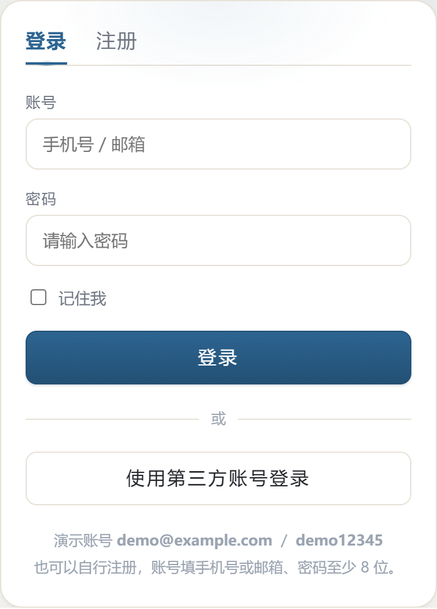

# 知音漫卷 · 手机安装与连接

> 适用：Android **1.9.0 及以后**
>
> 从 1.9.0 起，安装包不再挂在服务器上，改由 **GitHub Releases** 分发；
> App 内的「检查更新」也是从那里取地址。服务器只负责转述，见第 5 节。

> ⚠️ **原演示服务器（`123.56.172.230`）已停用**，Web 站与 API 均已下线。
> 因此：**APK 仍然可以下载和安装，但装好后需要自己有一个服务端才能登录**。
> 没有服务端时，App 只能打开登录页 —— 这是服务端的限制，不是安装包坏了。
> 自己起服务端见 [README 的「快速开始」](../README.md#快速开始)，约两条命令。

## 1. 下载安装

打开 GitHub 的「最新版本」页面，下载 `zhiyin.apk`：

```text
https://github.com/HeChunhui-learn/zhiyin-reader/releases/latest
```

永久下载地址（始终指向最新一版，可以直接收藏或做成二维码）：

```text
https://github.com/HeChunhui-learn/zhiyin-reader/releases/latest/download/zhiyin.apk
```

提示「此类文件可能有害」时选「仍然下载」；安装时允许「安装未知应用」。
国内网络打不开 GitHub 时，见第 6 节的备用办法。

## 2. 登录

<p align="center"></p>

**先填服务器地址。** 1.9.0 的安装包**没有内置服务器地址**（原演示服务器已下线，
没有"人人可用"的默认值可写），所以登录页会直接把「服务器地址」面板展开，
标题显示「未设置（必填）」：

```text
http://192.168.1.5:3000/api      ← 局域网里的电脑
https://your-domain.com/api      ← 有域名的话
```

填完点「保存」即可，不用重新装 App。地址存在本机，下次启动仍然生效；
填错了随时点「恢复默认」（恢复到空，重新填）。

> 为什么必须自己填：安装包里的默认地址只能在**打包时**写死（`VITE_API_BASE`），
> 服务端一旦换机器、换端口，写死的地址就失效。
> 从 1.9.0 起登录页就能改地址 —— 更早的版本只能进个人主页改，
> 而连不上服务器就进不去个人主页，等于锁死。**遇到这种情况请先升级到 1.9.0**。
>
> 1.8.x 及更早的安装包内置的是已停用的 `123.56.172.230`，
> 打开后会一直提示「连不上服务器」，属于同一类问题。

服务端里自带演示账号（`npm run seed` 后可用）：

```text
账号：demo@example.com
密码：demo12345
```

## 3. 更新

### App 内更新（推荐）

打开 App 时它会向服务端问一句"有没有新版"。有的话弹出一个**关不掉**的窗口，
点「立即下载更新」会跳到系统浏览器下载 `zhiyin.apk`，下载完点安装即可覆盖升级，
**不需要卸载**，本地书架和阅读进度都在。

网络不通或服务端抽风时**不会**被卡住 —— 查不到版本就正常放行，离线照样能读；
等联网后真正发请求时服务端还会再拦一次。

### 手动更新

直接去第 1 节的地址下载最新 `zhiyin.apk` 覆盖安装即可。

> ⚠️ 覆盖安装要求签名一致。本项目 1.9.0 起统一使用同一套发布签名；
> 如果你装的是更早的**未签名**版本，第一次升级需要**先卸载再装**（本地数据会丢，
> 书架内容可从服务端同步回来）。之后就能正常覆盖升级了。

> 注意：App 内检查更新要靠**服务端**转述 GitHub 的版本信息。没有服务端时
> 这一步会静默跳过（不会卡住），手动下载安装即可。

## 4. 无法连接服务端

最常见的原因是**没填服务器地址**，或者填的那个服务端没起。按顺序排查：

1. **先确认地址**。登录页的「服务器地址」是不是显示「未设置（必填）」？填自己的服务端，
   例如 `http://192.168.1.5:3000/api`。填过但连不上，就把地址重填一遍再试。
2. **用手机浏览器打开** `你的服务端地址去掉末尾 /api` + `/api/health`，
   例如 `http://192.168.1.5:3000/api/health`，正常应返回 `{"ok":true,...}`。
3. **浏览器也打不开**：确认服务端在跑（电脑上 `cd server && npm run server`）、
   手机和电脑在同一个网络、防火墙放行了 3000 端口。
4. **确认版本是 1.9.0 或更新**。旧版改不了登录页地址，会一直卡住。
5. **仍不行**：换 Wi-Fi / 移动数据，关闭 VPN、代理、广告拦截后再试。

| 现象 | 处理 |
|---|---|
| 提示「连不上服务器」 | 点登录页的「服务器地址」填对的地址（第 1 条） |
| 浏览器能开，App 不能 | 确认 App 里填的地址与浏览器一致，注意带上 `/api` |
| 浏览器也打不开 | 服务端没起或不在同一网络，见第 3 条 |
| 填过 `:3000` 却没写 `/api` | 会自动补 `/api`，但域名拼错补不回来，重填一次 |
| 安装提示签名冲突 | 先卸载旧版（见第 3 节的警告） |
| 提示强制更新 | 按第 1 节下载最新版 |

## 5. 发布新版本（维护者）

整个流程只有一步：**推一个 tag**。

```powershell
git tag v1.9.0
git push origin v1.9.0
```

剩下的由 `.github/workflows/android.yml` 自动完成：

1. 从 tag 算出 `versionName=1.9.0`、`versionCode=10900`（规则 `major*10000+minor*100+patch`）；
2. 带着这两个值构建前端，让 App 打开时能正确报出版本号；
3. `cap sync android` 后构建**签名** APK；
4. 发布 Release，附件固定叫 `zhiyin.apk`，正文里带一行机读标记
   `<!-- zhiyin:versionCode=10900 -->`。

服务端 `GET /api/app/version` 读 GitHub Releases API 拿到这三样东西再下发，
缓存 5 分钟。所以 tag 推上去后，**最多 5 分钟**手机端就能看到更新提示。

### 首次配置（只需做一次）

在仓库 `Settings → Secrets and variables → Actions` 添加四个 Secret：

| Secret | 值 |
|---|---|
| `ANDROID_KEYSTORE_BASE64` | 签名文件的 base64（见下） |
| `ANDROID_KEYSTORE_PASSWORD` | 签名文件的 storePassword |
| `ANDROID_KEY_ALIAS` | `zhiyin` |
| `ANDROID_KEY_PASSWORD` | 签名文件的 keyPassword |

生成签名文件（本机已有一份在 `client/android/keystore/`，**不进版本库**）：

```powershell
keytool -genkeypair -keystore zhiyin-release.jks -alias zhiyin `
  -keyalg RSA -keysize 2048 -validity 36500 `
  -dname "CN=Zhiyin Reader, OU=Software Engineering, O=CAUC, L=Beijing, ST=Beijing, C=CN"

# 转成单行 base64 填进 ANDROID_KEYSTORE_BASE64
[Convert]::ToBase64String([IO.File]::ReadAllBytes("zhiyin-release.jks"))
```

> ⚠️ **这套密钥丢了就完了**：没有它就无法给已装的 App 发更新，用户只能卸载重装。
> 请把 `.jks` 和两个密码单独备份（不要放进仓库）。

### 可选：给安装包一个默认服务器地址

工作流默认**不注入** `VITE_API_BASE`，所以新装的 App 打开会要求用户填地址。
如果你有一台长期可用的服务器，想在安装包里预置它：

`Settings → Secrets and variables → Actions → Variables` 新建一个**变量**（不是 Secret）：

| 变量 | 值 |
|---|---|
| `ZHIYIN_API_BASE` | `https://your-domain.com/api` |

之后构建的安装包就用它当默认值，用户不填也能直接登录（仍可手动改）。

### 重发某一版

Actions 页面选 `Android APK` → `Run workflow`，填版本号（如 `1.9.0`，不带 `v`）。
它签出对应的 tag 重新构建，并覆盖同一个 Release 的附件，不会新建版本。

## 6. GitHub 打不开怎么办

国内部分网络访问 GitHub Releases 会失败。三个办法，按省事程度排序：

1. **换网络**：移动数据 / 校园网 / 家里宽带轮流试一下，通常总有一个能通。
2. **改走自己的服务端中转**：把 APK 放到服务端静态目录（或任意能公网访问的位置），
   再把环境变量 `APP_APK_URL` 指过去（如 `https://你的域名/download/zhiyin.apk`），
   App 会改用这个地址下载 —— 客户端不用改，也不用重新打包。
3. **让朋友代下**：下载后通过微信/QQ 传文件，效果一样。

> 这正是"服务端代为查询 GitHub"的设计理由之一：手机端只需要连得上服务端，
> 版本检查和下载地址都由服务端给，不必每台手机都能直连 GitHub。

## 7. 服务器自检

把下面地址里的 `<基址>` 换成你自己的，例如 `http://192.168.1.5:3000/api`：

```text
健康检查：<基址>/health            → {"ok":true,...}
版本信息：<基址>/app/version       → 版本号、下载地址、是否强制更新
```

版本信息里的 `source` 字段能看出当前用的哪一路：

| `source` | 含义 |
|---|---|
| `github` | 正常状态，版本号与下载地址来自 GitHub Releases |
| `env` | GitHub 没查到（离线/限流/还没发过 Release/没配代理），用的是环境变量兜底值 |

> 服务器停用后这一节仍适用 —— 它说的是**你自己的**服务端，不是原来那台。

## 8. 注意

- **原演示服务器已停用**，装好 App 后需要自己准备服务端才能登录（见第 2 节与 README）。
- 目前是 HTTP，没有 HTTPS / 域名备案，仅适合演示。
- 演示账号是公共的，不要上传个人隐私或重要文件。
- 跟读无声时先检查手机网络；服务端使用的是在线中文音色（Edge TTS）。
